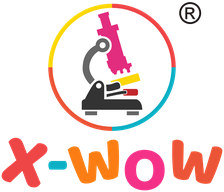

<p align="center">
  <picture>
    <source media="(prefers-color-scheme: dark)" srcset="src/assets/img/brand/xwow-logo-dark-192.png">
    
  </picture>
</p>

# X-WOW: inventions to steal, happily

The source of [x-wow.com](https://x-wow.com/). Test address: https://khcy82dyc2.github.io/x-wow/

X-WOW gives away free, open inventions for lab-grade seeing and making. Invention #1 is **SWELL**, a cheap, automated expansion microscope. It is designed on paper and simulated. The wet-lab protocol, the mechanical and fluidic designs and the instrument software are not written yet, and nobody has built one. Whoever builds it is welcome to claim the success.

## Build
```
python build.py
```
This needs Python 3.9+ and the standard library only. It turns `src/` into `docs/`, which GitHub Pages serves. The build fails on broken links or anchors, missing numbers, leftover placeholders and anything that looks personal.

- **Pages:** each page is `src/pages/<slug>/`, holding `_meta.json` and `NN-*.html` fragments, wrapped in `src/layout.html`.
- **Two languages:** elements with `class="en"` or `class="zh"`, switched by the 中文/EN button.
- **Numbers:** every number about an invention comes from `src/data/numbers_*.json`, with its source. The scripts in `tools/` regenerate those files from the simulation outputs.
- **Old links:** `src/redirects.json` maps old x-wow.com URLs to the new pages.
- **Logo:** `python tools/make_brand.py` (needs Pillow and NumPy) makes every logo size, the icons and the social preview from the two original files of the old site in `src/assets/img/brand/original/`. Nothing is redrawn: it only removes the white around the logo, keeps the white inside the ring (and fills the old favicon's see-through centre with white to match), and shows the ® mark light on dark backgrounds.

## Builders' wall
Open an issue with the **I'm building this** form. A maintainer adds the `on-the-wall` label, and the post appears on the home page.

## Licences
- **Text, data and code:** [CC0 1.0](https://creativecommons.org/publicdomain/zero/1.0/).
- **Hardware design files:** [CERN-OHL-P v2](https://ohwr.org/cern_ohl_p_v2.txt).
- **Exceptions:** three.js in `src/assets/vendor/three/` keeps its MIT licence. Names and works credited on the site belong to their owners.
- **Name and logo:** X-WOW is a trade mark, and the X-WOW logo (which includes the name) is a registered UK trade mark, UK00003425680. The logo artwork is not covered by CC0 or CERN-OHL-P wherever it appears: `src/assets/img/brand/`, `src/favicon.ico`, `src/assets/img/og-xwow.png` and their built copies in `docs/`. CC0 never affects trade marks anyway (section 4a).
- **Patents:** see the legal notes on each invention page before any commercial use.

## AI transparency
This site's text and code, and the SWELL design, simulations and documents, were produced with AI assistance (Claude by Anthropic, used through Claude Code). The X-WOW owner directed the work and approved it. Nothing here has been built or tested in a lab yet.
